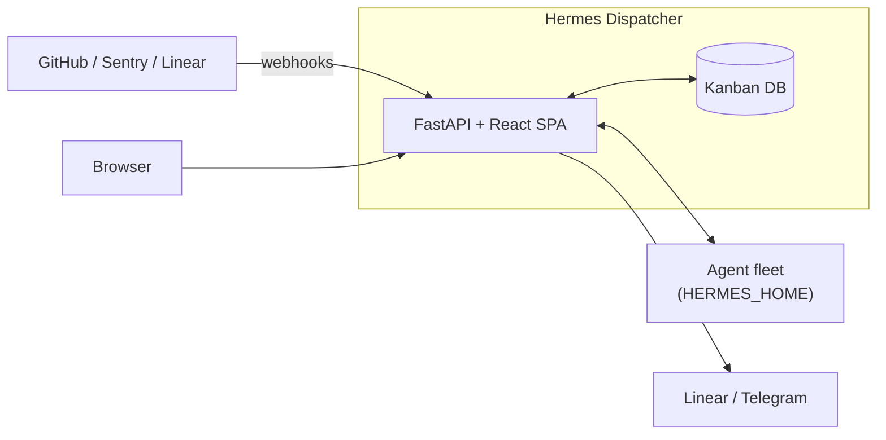

# Hermes Dispatcher

A web dashboard and FastAPI backend for operating a fleet of AI worker agents: chat, a Kanban board, a memory view, and webhook intake from Sentry, Linear and GitHub.

<!-- Screenshot: add docs/dashboard.png and reference it here -->
<!--  -->

## Architecture

A single uvicorn process serves the API, the webhook receivers and the built SPA. It reads agent state from `HERMES_HOME` and writes cards to the Kanban database. Background pollers keep Linear issues, Kanban cards and Sentry alerts in sync and auto-close resolved ones. The server reports its own errors to Sentry when `SENTRY_DSN` is set.

## Features

- **Kanban board**: cards carry a priority and an assignee profile and stream live over SSE.
- **Chat**: send messages into an agent session and stream the reply; file upload and a `/linear create` slash command.
- **Incident intake**: a Sentry alert becomes a Linear issue, then a Kanban card, then a Telegram message. Completing the card closes the Linear and Sentry issues.
- **Memory view**: an interactive canvas map of agent memory next to an editor for the memory files.
- **Observability**: token and cost analytics, system metrics (local, or from a metrics host over SSH), live log streaming and a session browser.
- **Fail-closed webhooks**: HMAC-SHA256 for GitHub, Sentry and Linear; bearer secret or passcode for the rest. An unset secret rejects the request with `503`.

## API Overview

All routes live under `/api` and require the `hd_session` cookie, except health, auth and the webhook receivers (which verify their own signatures). The full OpenAPI schema is served at `/docs`.

| Group | Purpose |
|---|---|
| Health / auth | Health check, login, logout, session check |
| Kanban | Create, list and update cards; live SSE stream |
| Linear | Issue search and triage (priority, labels) |
| Chat | Send messages, upload files, list sessions |
| Sessions / search | Browse, search and delete agent sessions |
| Memory / skills | Edit memory files, memory view data, manage skills |
| Observability | Overview, insights, system metrics, logs, cron output |
| Webhooks | GitHub, Sentry, Linear, Figma, Notion, knowledge, kanban |

## Configuration

Set secrets in a git-ignored `.env` file. These are the variables most deployments need:

| Variable | Default | Purpose |
|---|---|---|
| `HERMES_HOME` | `~/.hermes` | Agent data root |
| `HERMES_DISPATCHER_HOST` | all interfaces | Bind address |
| `HERMES_DISPATCHER_PORT` | `8787` | Bind port |
| `DASHBOARD_CORS_ORIGINS` | localhost only | Comma-separated CORS allowlist |
| `DASHBOARD_PUBLIC_URL` | `http://localhost:8787` | Base URL used in links sent to Linear |
| `WEBHOOK_SECRET` | none | Bearer secret for the knowledge and kanban hooks |
| `GITHUB_WEBHOOK_SECRET` | none | GitHub HMAC secret |
| `SENTRY_WEBHOOK_SECRET` | none | Sentry HMAC secret |
| `LINEAR_WEBHOOK_SECRET` | none | Linear HMAC secret |
| `LINEAR_API_KEY` | none | Linear API access |
| `TELEGRAM_BOT_TOKEN` | none | Telegram notifications |
| `SENTRY_DSN` | none | Error reporting for the server itself (unset = off) |

Additional options (Figma, Notion, Sentry auto-close, upload limits, database paths, poll intervals) are read from the environment in [`server.py`](server.py) and [`routes/`](routes).

## Stack

| Layer | Technology |
|---|---|
| Frontend | React 19, TypeScript 5.8, Vite 8, Tailwind CSS 3.4, three.js |
| Backend | Python, FastAPI 0.143, uvicorn 0.54 |
| Data | SQLite and JSON state files |
| Auth | Session cookie, bcrypt password hash, login rate limiting |
| Tests | pytest, `node --test` |

Run the tests with `pip install -r requirements-dev.txt && python -m pytest -q tests` and `cd app && npm test`.

## Related Repository

[**custom-hermesagent**](https://github.com/andrewalhaj/custom-hermesagent) is the agent-side companion: the plugins, scripts and skills that live in `HERMES_HOME`. This repository is the web service that reads that directory. Two backend routes import or call scripts from it (`routes/memory.py`, `routes/hooks.py`), so the two are best deployed together.

## Status and Limitations

- Early-stage (`0.1.0`), built for a single self-hosted deployment.
- Single worker only: sessions and the login rate limiter are in memory, so a restart logs everyone out.
- `POST /api/chat/cancel` is not implemented and always reports that cancel is unsupported.
- Some routes assume the original deployment (an agent interpreter path and default Linear and Sentry identifiers) and need adjusting for other environments.
- CI runs secret scanning only; the test suites are run locally.

## License

No license file is included yet. Until one is added, all rights are reserved by the author.
